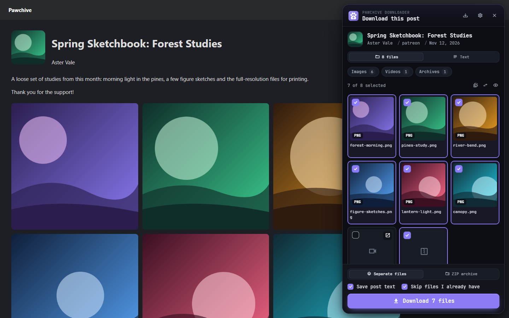
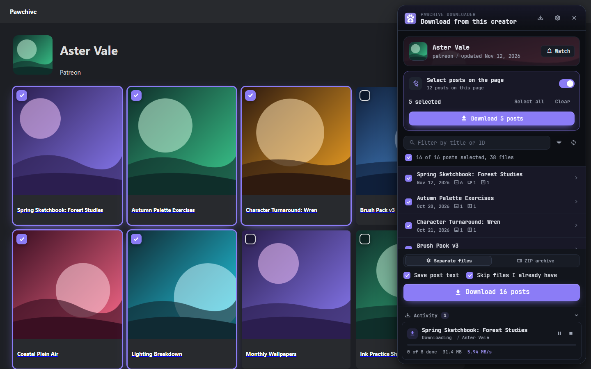
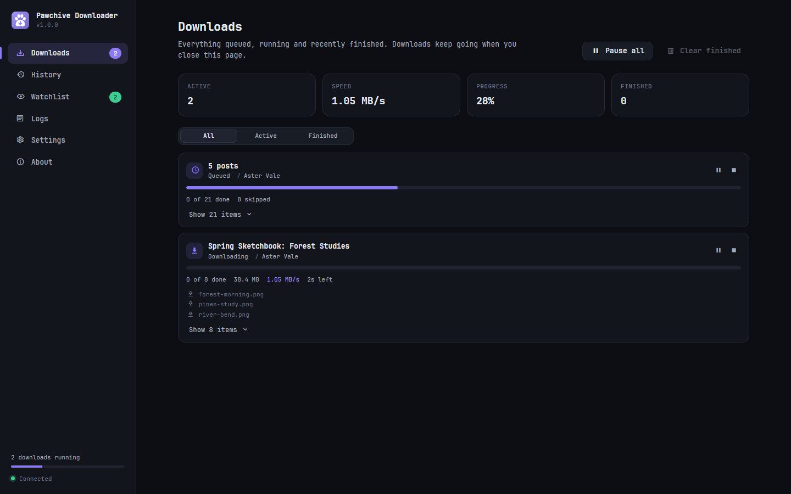
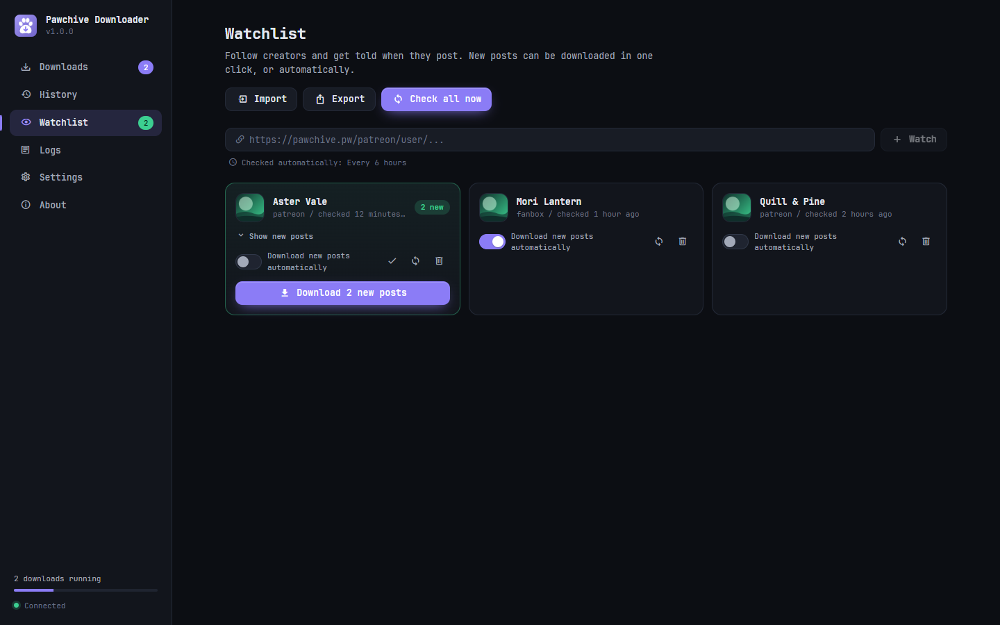
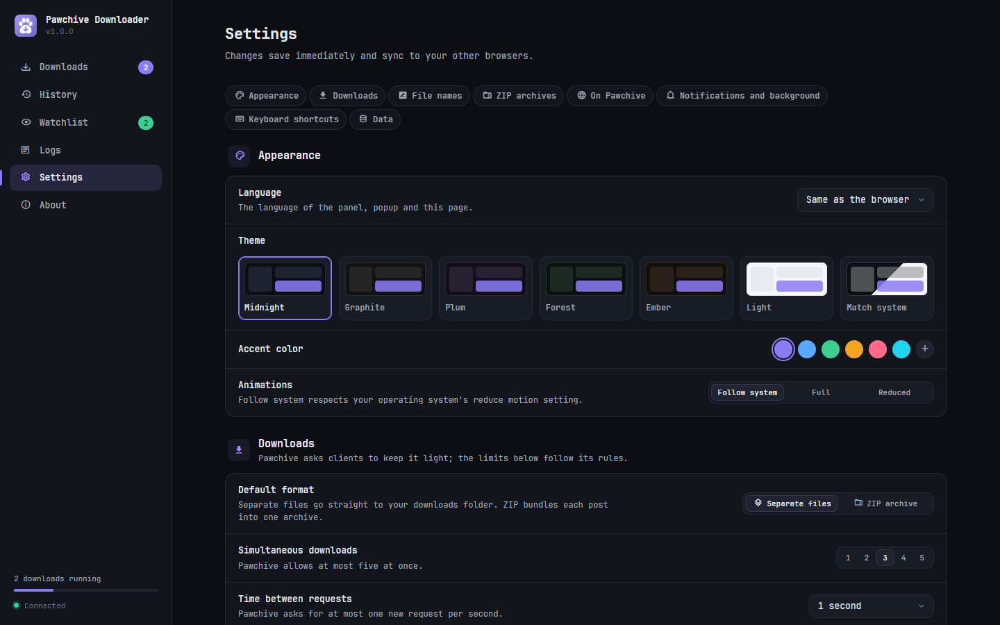
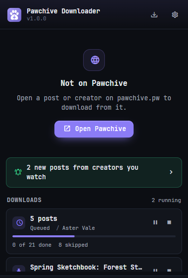

<h1 align="center">Pawchive Downloader</h1>

<p align="center">
  
</p>

<p align="center">
  Download posts, attachments and whole creators from <a href="https://pawchive.pw">Pawchive</a>, right in your browser.
</p>

<p align="center">
  <a href="https://github.com/VoxDroid/PawchiveDownloader-BrowserExtension/actions/workflows/ci.yml"></a>
  <a href="https://github.com/VoxDroid/PawchiveDownloader-BrowserExtension/actions/workflows/codeql.yml"></a>
  <a href="https://github.com/VoxDroid/PawchiveDownloader-BrowserExtension/releases"></a>
  <a href="LICENSE"></a>
  
  
</p>

<p align="center">
  
</p>

---

Pawchive Downloader adds a download panel to every post and creator page on Pawchive. Pick the files you want, save them as separate files or a ZIP archive, queue whole creators, and let a watchlist find new posts for you. It is the browser companion to [KemonoDownloader](https://github.com/VoxDroid/KemonoDownloader), rebuilt from scratch for Pawchive only.

## Contents

- [Features](#features)
- [Screenshots](#screenshots)
- [Installation](#installation)
- [Using it](#using-it)
- [File names and folders](#file-names-and-folders)
- [Settings](#settings)
- [Privacy and politeness](#privacy-and-politeness)
- [Development](#development)
- [Project structure](#project-structure)
- [Disclaimer and ethical use](#disclaimer-and-ethical-use)
- [Credits](#credits)
- [License](#license)

## Features

**Downloading**

| Feature                    | What it does                                                                                                                                                    |
| -------------------------- | --------------------------------------------------------------------------------------------------------------------------------------------------------------- |
| Download panel             | A floating paw button on every Pawchive page opens a side panel for the post, creator or list you are viewing.                                                  |
| File picking               | Thumbnails of every file with category filters (images, videos, audio, archives, documents, text), select all, invert, and Shift-click ranges.                  |
| Whole creators             | Load a creator's full post list, filter by title, date range and whether posts have files, and download any selection, or everything at once.                   |
| Selection on lists         | Tick posts directly on the site's own post cards on creator pages and search results, with Shift-click ranges.                                                  |
| ZIP archives               | Each post becomes one archive, streamed in the browser and split into numbered parts below the ZIP size limit. Videos and very large files are saved beside it. |
| Preview-only files         | When Pawchive only keeps a preview, the full file is fetched through the temporary link the post page offers.                                                   |
| Post text and metadata     | Save the description as `content.txt` and/or `content.html`, plus a `post.json` with title, dates, tags and files.                                              |
| Skip what you have         | Files are recognised by their content hash across posts and creators, so nothing downloads twice. Posts you saved get a badge on the site.                      |
| Context menu and shortcuts | Right-click any post or creator link to download or watch it. `Alt+Shift+D` toggles the panel, `Alt+Shift+A` downloads the open post.                           |

**Managing**

| Feature        | What it does                                                                                                                                               |
| -------------- | ---------------------------------------------------------------------------------------------------------------------------------------------------------- |
| Download queue | Pause, resume, cancel and retry each job or everything at once. Live speed, progress, time left and per-file status. Jobs survive browser restarts.        |
| Retries        | Network and server errors retry with growing, jittered pauses; disk and permission errors stop at once with a clear reason.                                |
| History        | Every finished download with files, size, duration and errors. Search, filter, show in folder, download again, export as CSV or JSON.                      |
| Watchlist      | Follow creators. New posts are found on a schedule (hourly to daily), shown with a badge and a notification, and downloaded in one click or automatically. |
| Logs           | A searchable, filterable log of what the extension did and why, with copy and save.                                                                        |

**Interface**

| Feature   | What it does                                                                                                                                                          |
| --------- | --------------------------------------------------------------------------------------------------------------------------------------------------------------------- |
| Design    | JetBrains Mono Nerd Font throughout, icons from the font itself, six themes (Midnight, Graphite, Plum, Forest, Ember, Light) plus Match system, and any accent color. |
| Motion    | Eased transitions, springy controls and virtualized lists that stay smooth with thousands of posts. Respects reduced motion.                                          |
| Languages | English, Japanese, Korean, Simplified Chinese, Spanish, Brazilian Portuguese, Russian, German and French, switchable live.                                            |
| Dashboard | Downloads, history, watchlist, logs, settings and an about page in a full tab. Settings sync across your browsers.                                                    |

## Screenshots

| Creator page with selection                            | Download queue                                         |
| ------------------------------------------------------ | ------------------------------------------------------ |
|    |  |
| **Watchlist**                                          | **Settings**                                           |
|  |    |

<p align="center"></p>

## Installation

Download the package for your browser from the [latest release](https://github.com/VoxDroid/PawchiveDownloader-BrowserExtension/releases/latest).

### Chrome, Edge, Brave, Vivaldi and other Chromium browsers

1. Download `pawchive-downloader-<version>-chrome.zip` (or `-edge.zip` for Edge) and unzip it.
2. Open `chrome://extensions` (`edge://extensions` in Edge) and turn on **Developer mode**.
3. Click **Load unpacked** and pick the unzipped folder.
4. Pin the paw icon to the toolbar.

Requires Chrome 116 or newer.

### Firefox

1. Download `pawchive-downloader-<version>-firefox.zip`.
2. Open `about:debugging#/runtime/this-firefox` and click **Load Temporary Add-on**.
3. Pick the downloaded zip (or `manifest.json` inside the unzipped folder).

Temporary add-ons are removed when Firefox restarts. Requires Firefox 140 or newer (142 on Android). If Firefox asks, allow access to `pawchive.pw`; Settings shows a banner when access is missing.

### From source

```bash
pnpm install
```

```bash
pnpm build
```

```bash
pnpm build:firefox
```

The unpacked extensions are written to `.output/chrome-mv3` and `.output/firefox-mv3`.

## Using it

1. Open a post or a creator on [pawchive.pw](https://pawchive.pw).
2. Click the paw button in the corner, press `Alt+Shift+D`, or open the toolbar popup.
3. On a post, pick files; on a creator, load the post list and pick posts; on any list, switch on **Select posts on the page** and tick cards.
4. Choose **Separate files** or **ZIP archive** and press **Download**.
5. Follow progress in the panel, the popup or the dashboard. Downloads keep going in the background.

Files are saved in your browser's downloads folder, organised by the folder template (by default `Pawchive/<creator> (<service>)/<date> <title> [<post id>]/`).

## File names and folders

Three templates decide where things go. They are edited in **Settings > File names** with a live example and presets.

| Token                              | Meaning                                                                                                       |
| ---------------------------------- | ------------------------------------------------------------------------------------------------------------- |
| `{service}`                        | Site the post came from (`patreon`, `fanbox`)                                                                 |
| `{creator}`, `{creator_id}`        | Creator name and ID                                                                                           |
| `{post_id}`, `{title}`             | Post ID and title                                                                                             |
| `{published}`, `{added}`, `{date}` | Publish date, archive date, download date; take a format such as `{published:YYYY-MM-DD}` or `{date:YYYY/MM}` |
| `{index}`, `{count}`               | File number in the post (`{index:3}` gives `007`) and number of files                                         |
| `{name}`, `{filename}`, `{ext}`    | Original name without and with extension, and the extension                                                   |
| `{hash}`                           | Content hash (`{hash:8}` for the first eight characters)                                                      |
| `{role}`                           | `file`, `attachment` or `inline`                                                                              |

Defaults:

| Template  | Default                                                                     |
| --------- | --------------------------------------------------------------------------- |
| Folder    | `Pawchive/{creator} ({service})/{published:YYYY-MM-DD} {title} [{post_id}]` |
| File name | `{index:2}_{filename}`                                                      |
| ZIP name  | `{creator} - {published:YYYY-MM-DD} {title} [{post_id}]`                    |

Every value is cleaned so names are valid on Windows, macOS and Linux: reserved names and characters, invisible direction marks and shortcut extensions are neutralised, `..` can never leave the downloads folder, and long paths are shortened while keeping the extension.

## Settings

| Area         | Settings                                                                                                                                                                                                                                   |
| ------------ | ------------------------------------------------------------------------------------------------------------------------------------------------------------------------------------------------------------------------------------------ |
| Appearance   | Language, theme, accent color, animations                                                                                                                                                                                                  |
| Downloads    | Default format, simultaneous downloads (1 to 5), time between requests, retries, what to do when a file exists, skip downloaded files, preview-only files (temporary link, preview image or skip), post text, metadata, default file types |
| File names   | Folder, file and ZIP templates with presets and a token reference                                                                                                                                                                          |
| ZIP archives | Largest archive (split above it), save videos beside the archive, save files above a size separately                                                                                                                                       |
| On Pawchive  | Floating button and its corner, panel side, selection on post lists, saved-post badges                                                                                                                                                     |
| Background   | Notifications, watchlist check interval, history recording, log level                                                                                                                                                                      |
| Data         | Export and import settings, reset to defaults                                                                                                                                                                                              |

## Privacy and politeness

- **No data collection.** No accounts, tracking or analytics. Settings sync through your browser's own sync; history, watchlist and logs stay on your device. The extension talks only to `pawchive.pw` and its file servers. See [PRIVACY.md](PRIVACY.md).
- **Polite by design.** Pawchive asks for at most five downloads at once and one new request per second. The extension enforces both across every download, ZIP archive and API call. When the site answers `429 Too Many Requests` (or `503` with `Retry-After`), every request waits for the cooldown, then resumes staggered so they do not stampede. The rules are the same as in KemonoDownloader.
- **Minimal permissions.** `downloads`, `storage`, `unlimitedStorage` (history and large queues), `contextMenus`, `notifications`, `alarms` (watchlist schedule), `offscreen` (Chrome only, to build ZIP archives) and access to `pawchive.pw`.

## Development

Requirements: Node.js 20 or newer and pnpm 10.

| Command                                                | Purpose                                                                        |
| ------------------------------------------------------ | ------------------------------------------------------------------------------ |
| `pnpm dev` / `pnpm dev:firefox`                        | Run with hot reload in a fresh browser profile                                 |
| `pnpm build` / `pnpm build:firefox` / `pnpm build:all` | Production builds                                                              |
| `pnpm zip:all`                                         | Store-ready zips for every browser                                             |
| `pnpm check`                                           | Lint, format check, type check, translation check and unit tests               |
| `pnpm test` / `pnpm test:coverage`                     | Vitest unit and component tests                                                |
| `pnpm test:e2e`                                        | Playwright end-to-end tests against a mocked Pawchive (run `pnpm build` first) |
| `pnpm lint:locales`                                    | Verify every translation                                                       |
| `pnpm lint:firefox`                                    | Mozilla's add-on linter on the Firefox build                                   |

Contributions are welcome; see [CONTRIBUTING.md](CONTRIBUTING.md). Translations live in `src/lib/i18n/locales/` and are described in [docs/TRANSLATING.md](docs/TRANSLATING.md). Releases are described in [docs/RELEASING.md](docs/RELEASING.md).

### Quality gates

CI runs on every push and pull request: ESLint, Prettier, `svelte-check`, the translation checker, unit tests with coverage on Linux, Windows and macOS, builds for Chrome, Edge and Firefox with Mozilla's add-on linter, and the Playwright suite. CodeQL scans the code and Dependabot keeps dependencies current. Tagged releases build every package and publish a GitHub release, and can submit to the stores.

## Project structure

```
src/
  entrypoints/
    background.ts        Download engine host, messaging, watchlist, menus, badge
    content/             In-page panel (Svelte, shadow DOM) and post card selection
    popup/               Toolbar popup
    options/             Dashboard: downloads, history, watchlist, logs, settings, about
    offscreen/           Chrome-only helper that builds ZIP archives
  lib/
    pawchive/            URLs, API client, normalization, relay links
    net/limiter.ts       Request pacing and rate-limit cooldowns
    jobs/                Planner (posts to download items) and the download engine
    zip/                 Streaming ZIP builder and its hosts
    download/            Path templates and file name sanitizing
    storage/             IndexedDB history and synced settings
    i18n/                Runtime translations and formatting
  ui/                    Design tokens, components, shared state, generated icon map
tests/
  unit/                  Vitest unit and component tests
  e2e/                   Playwright tests that load the built extension
scripts/                 Font subsetting, icons, locale tools, screenshots
```

A deeper tour is in [docs/ARCHITECTURE.md](docs/ARCHITECTURE.md).

## Disclaimer and ethical use

Pawchive Downloader is a tool for personal and educational use. The maintainers do not condone the unauthorized distribution of copyrighted material. You are responsible for making sure you have the right to access and download content, and for following the law and the terms of the platforms the content comes from.

Creators rely on their supporters. Download only what you are entitled to, keep it for personal use, and support the creators you enjoy on their own pages. This project is not affiliated with Pawchive.

## Credits

- Built by [VoxDroid](https://github.com/VoxDroid), companion to [KemonoDownloader](https://github.com/VoxDroid/KemonoDownloader).
- [JetBrains Mono Nerd Font](https://github.com/ryanoasis/nerd-fonts) under the SIL Open Font License 1.1 (see `public/fonts/OFL.txt`).
- [WXT](https://wxt.dev), [Svelte](https://svelte.dev) and [fflate](https://github.com/101arrowz/fflate).

## License

[MIT](LICENSE)
